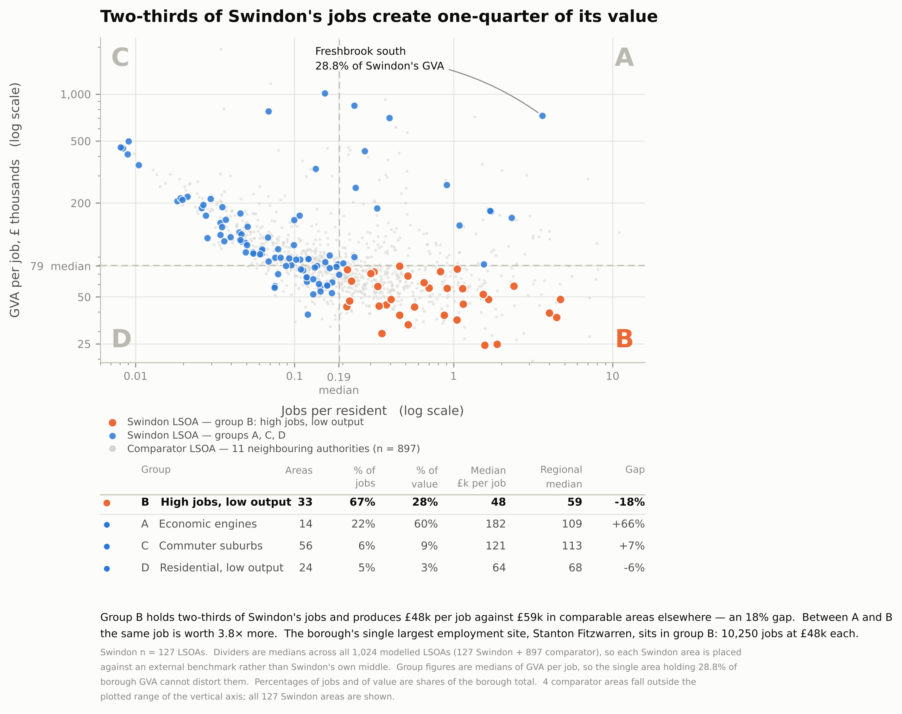

# Swindon LSOA Economic Growth Analysis

A neighbourhood-level diagnosis of where economic value is produced in Swindon (UK),
built on 1,024 Lower Layer Super Output Areas — 127 in Swindon and 897 in eleven
neighbouring authorities used as an external benchmark.

The question behind the project is a practical one for a local authority: Swindon knows
its total output, but not **which** of its neighbourhoods produce it, and whether the
neighbourhoods that hold the jobs are the same ones that hold the value. I built a
feature set from 83 raw indicators, tested four modelling approaches against LSOA-level
GVA, and turned the result into a four-group typology plus two Tableau dashboards.

**English** · [中文说明](README.zh-CN.md)

---

## Headline finding

Two-thirds of Swindon's jobs sit in neighbourhoods that produce roughly a quarter of its
value, and those same neighbourhoods underperform comparable areas elsewhere in the region
by 18%.



Every Swindon LSOA is placed against the median of all 1,024 modelled areas
(0.191 jobs per resident, £79.3k GVA per job) rather than against Swindon's own middle,
so the groups are measured against an external benchmark:

| Group | Description | Areas | % of jobs | % of value | Median £k/job | Regional median | Gap |
|---|---|---:|---:|---:|---:|---:|---:|
| **B** | High jobs, low output | 33 | 67.3% | 27.7% | 48.3 | 59.1 | **−18.3%** |
| A | Economic engines | 14 | 22.0% | 60.1% | 181.8 | 109.3 | +66.3% |
| C | Commuter suburbs | 56 | 5.5% | 9.2% | 120.6 | 113.0 | +6.8% |
| D | Residential, low output | 24 | 5.2% | 2.9% | 63.9 | 68.1 | −6.1% |

Between groups A and B the same job is worth **3.76× more**. The borough's largest
employment site (Stanton Fitzwarren, 10,250 jobs) sits in group B at £48k per job, while a
single area — Freshbrook south — accounts for 28.8% of all borough GVA. Group figures are
medians, so that one area cannot distort them.

For a council, this reframes the problem: the weakness is not a job shortage but the value
density of jobs that already exist.

---

## Data

| | |
|---|---|
| Unit of analysis | LSOA (2021 boundaries), ~1,500 residents each |
| Rows | 1,129 LSOAs · 140 in Swindon, the rest in 11 comparator authorities |
| Modelled rows | 1,024 with a GVA estimate — 127 Swindon, 897 comparator |
| Raw columns | 83 |
| Target | `LSOA GVA Estimates (millions)` |

**Comparator authorities:** Bracknell Forest, Cherwell, Oxford, Reading, Slough,
South Oxfordshire, Vale of White Horse, West Berkshire, West Oxfordshire,
Windsor and Maidenhead, Wokingham.

**Indicator groups:** index of multiple deprivation and its income / employment /
education / adult-skills sub-deciles · Census 2021 qualification levels · mid-2024
population and working-age share · full-time, part-time and total employees ·
VOA rateable values for 2023 and 2026 with percentage change · enterprise counts by size
band and turnover band, sector shares (KIBS, creative, industrial, foundational,
green-aligned, anchor) and a Herfindahl-based diversity index · broadband speed and
coverage · bus-stop density and distance to the primary road network.

Eight of the eighteen model predictors are published at MSOA level and therefore repeat
across the LSOAs inside an MSOA. That single fact drives the validation design below.

The target is heavily right-skewed: one area holds 28.8% of borough GVA, so every model is
fitted on `log(1+x)` and back-transformed for evaluation on the original scale.

---

## Method

### 1 · Feature assembly and MSOA aggregation — `notebooks/01`

Joins the indicator tables onto the 2021 LSOA frame, attaches local place names, and
aggregates Swindon's 140 LSOAs up to its 27 MSOAs. Sums are checked against their
pre-aggregation totals row by row, and rate columns are recomputed from their numerators
and denominators rather than averaged, since averaging a rate across unequal populations
is wrong. Output: `data/msoa_features.csv`, the input for the MSOA dashboard.

### 2 · Exploratory analysis — `notebooks/02`, `notebooks/03`

Missingness profile, correlation structure against GVA, and a z-score profile of the top
outlier areas, run separately for Swindon and for the comparator set so that Swindon's
pattern can be read as either local or regional.

### 3 · Linear baseline — `notebooks/04`, `notebooks/05`

Ordinary least squares on four predictors with a random train/test split. This is the
baseline that fails, and it fails informatively: inside Swindon the test R² is **−1.63**
against a training R² of 0.351. A random split puts LSOAs from the same MSOA on both sides
of the split while the heavy tail lands in one of them, so the model is both leaking and
unable to represent the skew. That result is what motivates everything after it.

### 4 · Random Forest with grouped cross-validation — `notebooks/06`, `notebooks/07`

The main model, identical in specification for Swindon and for the comparator set:

- **Target** — `log1p(GVA)` via `TransformedTargetRegressor`, back-transformed with `expm1`
  so metrics are reported in £m
- **Predictors** — 18 variables spanning deprivation, employment intensity, enterprise
  structure, sector composition, skills and accessibility
- **Estimator** — 300 trees, max depth 6, min 5 samples to split, min 2 per leaf,
  max feature fraction 0.8, bootstrap, fixed seed
- **Missing values** — median imputation inside the pipeline, fitted per fold so no test
  fold ever informs its own imputation
- **Validation** — five-fold `GroupKFold` grouped by `MSOA21CD`. Because eight predictors
  are MSOA-level and repeat across an MSOA's LSOAs, an ungrouped split would place
  near-duplicate rows in both training and validation and inflate the score. Grouping is
  the difference between an honest number and a flattering one
- **Importance** — cross-validated permutation importance, measured as the mean increase in
  MAE after shuffling each predictor in held-out data

### 5 · Ablation — `notebooks/06`

A deliberate attempt to break my own model by asking how much of it is one variable:

| Predictor set | n predictors | R²(log1p) |
|---|---:|---:|
| Employment intensity alone | 1 | 0.699 |
| All predictors | 18 | **0.727** |
| All except employment intensity | 17 | 0.445 |

The other seventeen variables add +0.029. Removing employment intensity costs −0.283.

### 6 · Unsupervised cross-check — `src/pca_kmeans_*.py`, `src/decision_tree_gva.py`

PCA (target excluded from the feature matrix) plus k-means at k = 4, run separately for
Swindon and the comparators, and a depth-limited decision tree tuned by grid search. These
exist to test whether the Random Forest's story survives a method that was not told what
the target is. PC1 and PC2 carry 24.1% and 16.2% of variance in Swindon; the Swindon
clusters split 33 / 53 / 18 / 23.

### 7 · Typology and dashboards — `src/make_typology_figure.py`, `tableau/`

The figure at the top, and two packaged Tableau workbooks for the council audience.

---

## Results

| Model | Scope | n | Validation | MAE (£m) | Median AE | RMSE | R² |
|---|---|---:|---|---:|---:|---:|---:|
| Linear regression | Swindon | 121 | random holdout | 98.29 | — | 149.87 | **−1.631** |
| Linear regression | Comparators | 820 | random holdout | 73.41 | — | 184.06 | 0.054 |
| Random Forest | Swindon | 127 | 5-fold GroupKFold | 64.88 | 5.24 | 295.65 | 0.143 |
| Random Forest | Swindon, outlier removed | 126 | 5-fold GroupKFold | 40.39 | 5.23 | 96.37 | 0.369 |
| Random Forest | Comparators | 897 | 5-fold GroupKFold | 44.27 | 6.70 | 206.97 | 0.342 |
| Decision tree | All areas | 1,024 | grid-searched holdout | 94.24 | — | — | 0.722 (log) |

Permutation importance, Random Forest:

| Rank | Swindon | Δ MAE | Comparators | Δ MAE |
|---:|---|---:|---|---:|
| 1 | employment intensity | **28.05** | employment intensity | **43.39** |
| 2 | enterprise diversity (1−HHI) | 0.80 | micro-enterprise share | 0.64 |
| 3 | IMD decile | 0.38 | full-to-part-time ratio | 0.59 |

The gap between first and second place is a factor of thirty-five.

---

## What the numbers actually support

Written out plainly, because a model that is read too generously is worse than no model.

**The median error is small; the mean error is not.** Median absolute error is £5.2m
against a mean of £64.9m, and fold-level R² ranges from −0.403 to 0.493. With 127 areas and
one of them holding 28.8% of the total, aggregate R² is dominated by whichever fold owns
the tail. Dropping that single area moves R² from 0.143 to 0.369 — the model describes
ordinary neighbourhoods adequately and the largest site badly.

**Employment intensity is not one predictor among eighteen; it is the model.** The ablation
shows seventeen variables adding +0.029, and the decision tree — which was offered every
numeric column, including absolute employee counts — spends 82% of its importance on
part-time employees and 18% on total employees, with every other column at exactly zero.
Two methods with different feature sets and different estimators converge on the same
answer.

**That convergence is most likely a property of the data, not a discovery about Swindon.**
LSOA GVA is a modelled estimate rather than a measured quantity, and apportioning
higher-geography output down to small areas by employment would produce exactly this
signature. The honest reading is that the feature set adds little beyond employment once
employment is present — which is a finding about what these published estimates can and
cannot support, and a reason to treat the deprivation and sector variables as descriptive
context rather than as drivers.

**Permutation importance measures predictive association, not causation.** Nothing here
licenses a claim that changing a variable would change GVA.

**The typology does not depend on the regression at all.** It is built from observed jobs,
observed GVA per job, and external medians, which is why it carries the headline rather
than the model does.

---

## Repository layout

```
.
├── data/                                 # inputs, unpacked from the Tableau workbooks
│   ├── features.csv                      #   1,129 LSOAs × 83 indicators
│   ├── msoa_features.csv                 #   27 Swindon MSOAs, built by notebook 01
│   ├── Swindon LSOA local names.xlsx     #   LSOA code → local place name
│   └── Swindon LSOA local names.csv      #   same lookup, csv for the scripts
├── notebooks/
│   ├── 01_msoa_aggregation.ipynb         # feature assembly, LSOA → MSOA, sum checks
│   ├── 02_eda_swindon.ipynb              # missingness, correlations, outlier profiles
│   ├── 03_eda_comparators.ipynb          # same analysis, comparator authorities
│   ├── 04_linear_regression_swindon.ipynb    # OLS baseline (the informative failure)
│   ├── 05_linear_regression_comparators.ipynb
│   ├── 06_random_forest_swindon.ipynb    # main model + ablation
│   └── 07_random_forest_comparators.ipynb    # same framework, 897 comparator LSOAs
├── src/
│   ├── make_typology_figure.py           # the four-quadrant figure
│   ├── pca_kmeans_swindon.py             # PCA + k-means, k = 4
│   ├── pca_kmeans_comparators.py
│   └── decision_tree_gva.py              # grid-searched tree, importance cross-check
├── figures/                              # committed figures
├── outputs/                              # metrics, predictions, generated csv (gitignored)
├── tableau/
│   ├── Swindon_LSOA_Dashboards.twbx      # LSOA level — 2 dashboards, 6 worksheets
│   └── Swindon_MSOA_Dashboards.twbx      # MSOA level
└── requirements.txt
```

---

## Reproducing

```bash
pip install -r requirements.txt
```

Notebooks and scripts read from `../data/` and write to `../outputs/`, so each is run from
its own directory:

```bash
cd notebooks && jupyter lab        # run 01 → 07 in order
```

```bash
cd src
python make_typology_figure.py     # → ../figures/fig_typology.{png,pdf}
python pca_kmeans_swindon.py       # → ../outputs/pca_kmeans_swindon/
python pca_kmeans_comparators.py   # → ../outputs/pca_kmeans_comparators/
python decision_tree_gva.py        # → ../outputs/decision_tree/
```

Every figure and every number in this README was regenerated from `data/` on a clean
checkout. Seeds are fixed (`random_state = 123` for the unsupervised scripts and the tree,
a fixed seed inside the Random Forest pipelines), so the metric tables reproduce exactly.

---

## Tableau dashboards

`tableau/Swindon_LSOA_Dashboards.twbx` — data packaged inside the workbook, including the
ONS December 2021 LSOA boundary file:

- **Swindon Economic Performance** — top 10 LSOAs by GVA · GVA against employment ·
  indicator map
- **Inclusive Growth & Local Constraints** — deprivation against qualifications ·
  highest no-qualification areas · rateable-value change distribution

`tableau/Swindon_MSOA_Dashboards.twbx` — the same borough at MSOA level, built on
`data/msoa_features.csv`.

---

## Limitations

- **127 Swindon areas with a GVA estimate.** Small-sample variance is visible in the fold
  spread and is not hidden here.
- **The target is an estimate.** LSOA GVA is modelled from higher-geography output, which
  bounds what any model fitted to it can claim.
- **Eight predictors are MSOA-level**, so within-MSOA variation in those variables is zero
  by construction. `GroupKFold` prevents the leakage; it cannot create information that
  the published data does not contain.
- **Cross-sectional.** VOA rateable value appears for 2023 and 2026, but everything else is
  a single snapshot, so nothing here supports a claim about change over time.
- **Correlational throughout.**

---

## Stack

Python 3.11+ · pandas · NumPy · scikit-learn · Matplotlib · seaborn · Jupyter · Tableau

Indicators are derived from published UK open data: ONS (population, Census 2021
qualifications, 2021 boundaries), the Valuation Office Agency (rateable values),
the English Indices of Deprivation, and Ofcom-derived broadband coverage.
